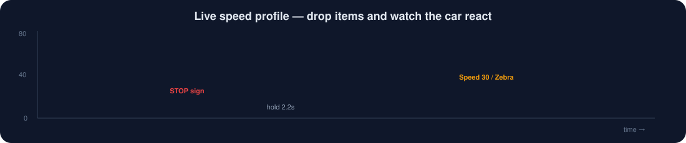
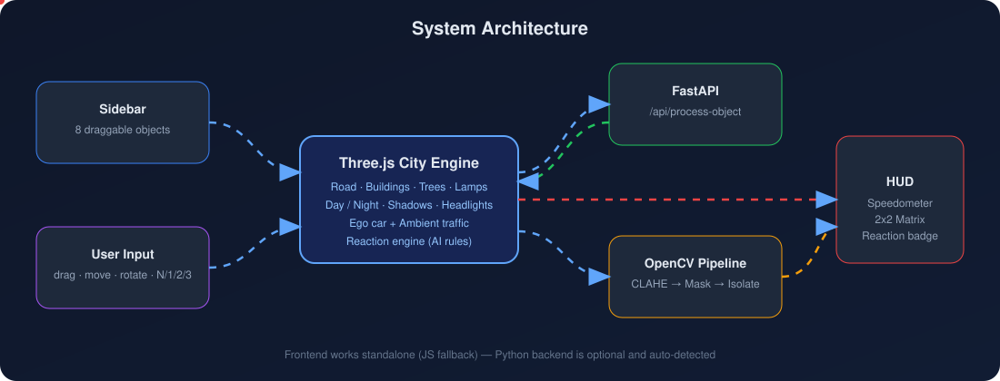
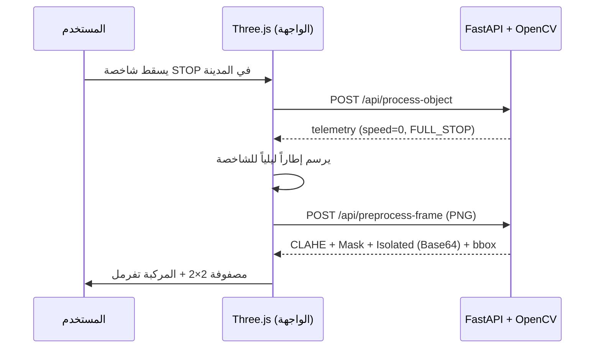
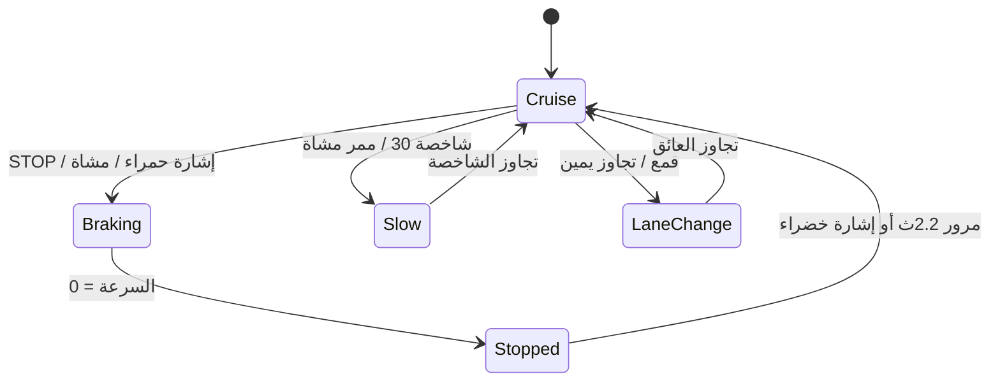

<div align="center">



# 🚗 TSR-PreProcessor — Autonomous Driving 3D City Simulator

**نظام المعالجة الأولية الذكي لشاخصات المرور + محاكاة قيادة ذاتية ثلاثية الأبعاد داخل مدينة**


[English](#-english-summary) • [الميزات](#-الميزات) • [التشغيل](#-التشغيل-السريع) • [المعمارية](#-المعمارية) • [Spline](#-استخدام-مجسمات-spline-glb) • [API](#-واجهة-الـ-api)

</div>

>

---

## ✨ الميزات

| | الميزة | التفاصيل |
|---|---|---|
| 🏙️ | **مدينة ثلاثية الأبعاد** | طريق بأربعة مسارات (خط أصفر مزدوج، حواف، خطوط متقطعة)، تقاطعات، ممرات مشاة، أرصفة وحواف، مبانٍ بـ 6 أنماط واجهات مع محلات وتفاصيل أسطح، أشجار، أعمدة إنارة |
| 🌗 | **نهار / ليل** | انتقال سلس: سماء + نجوم + قمر، **ظلال حقيقية**، نوافذ المباني تضيء، أعمدة الإنارة تعمل، **كشافات السيارة (SpotLight)** وإضاءة خلفية وفرامل |
| 🚘 | **سيارة احترافية** | هيكل مُنحنٍ (Extrude + Bevel) بطلاء PBR مع Clear-coat، زجاج عاكس، 4 عجلات بدوران حقيقي وتوجيه أمامي، مرايا، شبك، لوحات، ميل الجسم عند الكبح |
| 🖱️ | **تحريك العناصر داخل المدينة** | اسحب أي عنصر بعد إسقاطه لتغيير موضعه (مغناطيس للمسارات/الأرصفة) • `R` تدوير • `Del` حذف • قائمة بالعناصر الموجودة |
| 🎥 | **كاميرات** | خلفية (قابلة للتدوير بالماوس) • منظور السائق • علوية — مفاتيح `1 2 3` |
| 🧠 | **منطق قيادة ذاتية** | كبح واقعي (v = √2·a·d)، انتظار عند STOP، دورة إشارة حقيقية (أحمر/أخضر/أصفر)، مشاة يعبرون، تفادي القمع بتغيير المسار، تتبّع المركبة الأمامية |
| 🔬 | **مصفوفة OpenCV 2×2** | CLAHE ← قناع HSV أحمر ← عزل الشاخصة + Bounding Box. تعمل عبر **Python/OpenCV** إن كان الخادم متصلاً، وإلا تعمل **محلياً بالجافاسكربت** بنفس الخوارزمية |

<div align="center">

<br/><sub>مراحل المعالجة الأولية (رسم متحرك)</sub>
</div>

---

## 🚀 التشغيل السريع

### الخيار 1 — بدون أي تثبيت (واجهة فقط)
افتح `index.html` في المتصفح (يُفضَّل عبر Live Server). تحتاج إنترنت لتحميل Three.js وTailwind من CDN.

### الخيار 2 — كامل (واجهة + Python/OpenCV)
```bash
python -m venv venv
source venv/bin/activate          # ويندوز: venv\Scripts\activate
pip install -r requirements.txt
uvicorn main:app --reload --port 8000
```
ثم افتح **http://localhost:8000** — الخادم يقدّم الواجهة أيضاً، وستظهر الشارة **«Python/OpenCV متصل»** أعلى الصفحة.

### 🎮 التحكم

| الإجراء | الاختصار |
|---|---|
| إسقاط عنصر | اسحبه من القائمة اليمنى إلى المدينة (أو انقر عليه) |
| تحريك عنصر | اسحبه بالماوس داخل المدينة |
| تدوير / حذف | `R` / `Delete` |
| نهار ↔ ليل | `N` أو زر 🌙 |
| الكاميرا | `1` خلفية • `2` سائق • `3` علوية • عجلة الماوس للتقريب • اسحب الخلفية للدوران |

---

## 🧩 العناصر الثمانية وردّ فعل المركبة

| # | العنصر | ردّ الفعل |
|---|---|---|
| 1 | شاخصة تخفيف السرعة | تخفيض السرعة إلى **30 كم/س** |
| 2 | شاخصة STOP | توقف كامل، انتظار ~2 ثانية، ثم المتابعة |
| 3 | تجاوز من اليمين | الانتقال للمسار الأيمن + سرعة 50 |
| 4 | قمع مروري | مناورة تفادي بتغيير المسار + سرعة 25 |
| 5 | إشارة مرورية | تتغير فعلياً (أحمر 6ث ← أخضر 5ث ← أصفر)؛ توقف عند الأحمر |
| 6 | مشاة | يبدأ بعبور الطريق عند اقتراب السيارة؛ فرملة حتى يخرج من الطريق |
| 7 | ممر مشاة | تخفيف السرعة إلى 20 |
| 8 | مركبة أمامية | مطابقة السرعة (40) والحفاظ على مسافة الأمان |

<div align="center"></div>

---

## 🏗️ المعمارية

<div align="center"></div>





### 📁 هيكل المشروع
```
MiniProject/
├── index.html            # الواجهة (Tailwind + HUD + مصفوفة OpenCV)
├── js/
│   ├── models.js         # مكتبة المجسمات 3D (سيارة، شاخصات، إشارة، مشاة، مبانٍ، أشجار)
│   ├── app.js            # المدينة، نهار/ليل، الكاميرا، السحب، منطق القيادة
│   └── pipeline.js       # CLAHE + HSV Mask بالجافاسكربت (Fallback) + رسم الإطار
├── main.py               # FastAPI + OpenCV
├── requirements.txt
├── assets/               # الرسوم المتحركة (SVG) + مجلد models/ لملفات GLB
└── legacy/               # النسخة القديمة من المشروع (للمرجعية)
```

---

## 🎨 استخدام مجسمات Spline (GLB)

المجسمات الحالية **مبنية برمجياً** (هندسة حقيقية + خامات PBR) ولا تحتاج ملفات خارجية. لاستبدال أي مجسم بنموذج صنعته في [Spline](https://spline.design):

1. في Spline: **Export → GLB** (أو GLTF).
2. سمِّ الملف حسب نوع العنصر وضعه في `assets/models/`:

```
speed_limit.glb  stop_sign.glb  pass_right.glb  cone.glb
traffic_light.glb  pedestrian.glb  zebra.glb  vehicle.glb
```
3. شغّل المشروع عبر خادم (`uvicorn` أو Live Server — **لا** عبر `file://`)؛ سيستبدل التطبيق المجسم تلقائياً عند الإسقاط، ويعود للمجسم البرمجي إن لم يجد الملف.

> اجعل أصل النموذج عند القاعدة (y=0)، والوجه الأمامي نحو `+Z`، ومقياسه بالمتر.

---

## 🔌 واجهة الـ API

| Method | Path | الوصف |
|---|---|---|
| GET | `/api/health` | حالة الخادم |
| POST | `/api/process-object` | `{object_type, object_name}` ← سرعة/إجراء المركبة |
| POST | `/api/preprocess-frame` | صورة (multipart) ← `mask_pixels` + `bbox` + مراحل Base64 |

التوثيق التفاعلي: `http://localhost:8000/docs`

---

## 🛠️ الضبط

ثوابت في أعلى `js/app.js`: `CRUISE` (سرعة الرحلة) • `LANES` • `MAX_OBJECTS` • ألوان السماء `DAY`/`NIGHT` • شدة الشمس في `applyNight()`.

### 🩺 استكشاف الأخطاء
- **المشهد أسود/مظلم:** يتحوّل المشروع تلقائياً إلى «الوضع الآمن» (`?safe=1`، خامات Lambert). يمكنك فتحه يدوياً: `index.html?safe=1`.
- **انعكاسات واقعية (تجريبي):** `index.html?env=1` (قد لا تعمل على بعض بطاقات الرسوم).
- أي خطأ آخر: افتح `F12 → Console`.

## 🗺️ خارطة الطريق
- [ ] ربط نموذج YOLO حقيقي بعد مرحلة العزل
- [ ] طقس (مطر/ضباب) وإنارة الشوارع المبتلة
- [ ] تسجيل جلسات المحاكاة وتصدير CSV

---

## 🌍 English Summary

An interactive **3D autonomous-driving simulator** (Three.js) coupled with a **traffic-sign preprocessing pipeline** (OpenCV: CLAHE → HSV red mask → isolation + bounding box) served by FastAPI. Features a procedurally modeled city with day/night cycle, real shadows, car headlights, draggable/movable road objects, three camera modes and rule-based driving behavior. The frontend works standalone with a JS implementation of the same pipeline; start `uvicorn main:app` to use real OpenCV. Optional GLB models (e.g. exported from Spline) can override any procedural model via `assets/models/<type>.glb`.

```bash
pip install -r requirements.txt && uvicorn main:app --port 8000   # → http://localhost:8000
```

## 📄 License
MIT — see `LICENSE`.
